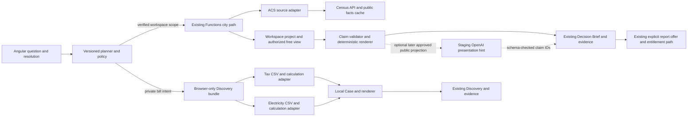
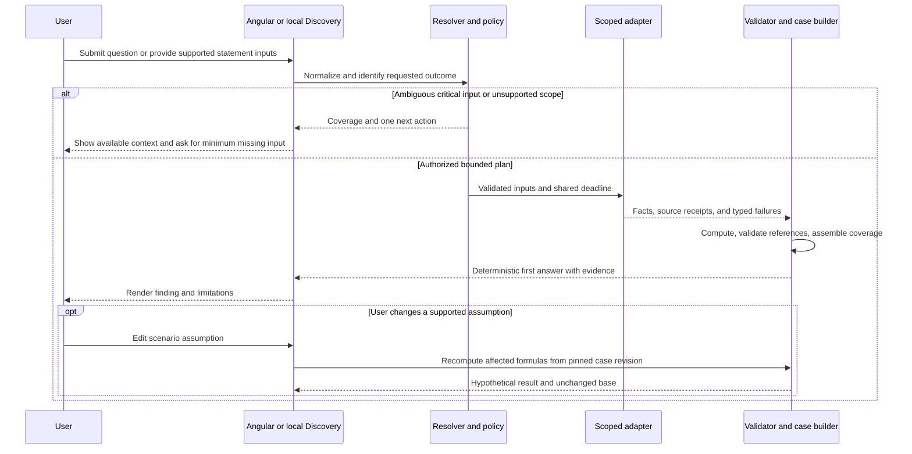

# ADR — Universal Decision Intelligence 4.0

**Proposed · November 16, 2026 · OpenAI / Codex.** This is an architecture decision for founder review. Runtime work needs review in separate implementation PRs. See [reference TypeScript contracts](contracts.ts), [security and budgets](CONTROLS.md), and [migration and evaluation](DELIVERY.md).

## Decision

Use a versioned DecisionCase and a typed tool registry with two execution boundaries. Angular resolves common questions and presents a deterministic answer. The city adapter calls the existing authorized Functions/Census path. The tax and electricity adapters run in the existing offline Discovery build. A bounded planner can name zero, one or two independent operations in a single execution boundary. The initial product runs one tool per turn, with one limited two-tool plan reserved for explicit requests for both statement comparisons in the browser once supported inputs for both are present. There is no cross-boundary execution plan.

Keep the Electric Minimal components. Ask accepts a question, Understand resolves it or asks only for a missing field, Analyze produces checked facts and calculations, Explain renders claim IDs and limitations, and Decide offers an actionable next check. Keep report access and pricing under existing server authorization. The first useful result never depends on optional AI presentation.

## Repository audit

Audited Electric Minimal master `921d55b65800722e001c1df35993241b0d88deac`, the accepted #106 head and the separate #96 staging draft. GitHub now records #106 merged at `4765a5cd0ee7eff598f02e74f5a50de94a7d3772` with a successful [production workflow](https://github.com/alwat83/ifyoumind/actions/runs/44005130946). These are source and workflow observations. Production runtime was outside this audit.

| Surface | Existing capability and limitation | Reuse |
| --- | --- | --- |
| Question entry and result | Protected `/app/decide` and `/app/result/:projectId`; existing bill routing distinguishes local rate, bill correctness, and private statement changes. [PR #106](https://github.com/alwat83/ifyoumind/pull/106) adds deterministic city and optional salary extraction, partial prefill, direct free brief, evidence limits, and same-browser reuse of a known result ID. It cannot recover a completed create whose response was lost. | Define a narrow mapping from #106's normalized output. Preserve its fallback and actions-to-answer tests. Domain classifiers on the existing paths stay authoritative until parity. |
| City and market | `createMarketIntelligenceProject` authenticates workspace owner/admin, uses existing free-decision policy, resolves Census places, saves `marketProjects`, and derives a free/full view. ACS variables are place population, median household income, and median home value. The population calculation compares distinct 2019 and 2024 five-year estimates. Cache keys include vintages, state and normalized city; the place reader has no age check. The current growth metric points to the current-year query, so a two-vintage evidence mapping is needed before treating it as fully traceable. There are no rent, tariff, personal expenses, property-tax rates, site-level business costs or margins of error in the existing metric payload. | Keep existing access and response contracts. Factor provenance and the minimal calculation interface out of the current adapter. Preserve source/estimate caveats. |
| Local property-tax Discovery | The CSV path compares two consecutive annual statements in USD, with county, school, and municipal components that add to each total. The user supplies statements for the same property. The form can't verify the property, assessment, exemptions, tax rates or correctness. | Keep its parser, validations, cents arithmetic, component changes and cell evidence in the browser. |
| Local electricity Discovery | The CSV path compares two non-overlapping periods with equal billed days and the same start month/day in adjacent years for one user-identified meter. It uses billed USD and kWh, with fixed/variable/other components only when bill labels and sums support the split. The ratio is whole-bill USD/kWh, which cannot establish an approved tariff or causation. | Keep grammar, date and unit validation, precise unit-cost arithmetic and cell references. |
| Universal dataset Ask | `askUniversalIntelligence` is limited to authorized workspace datasets with daily quotas and observation bounds. It is an existing separate product flow and does not give this design access to arbitrary datasets or APIs. | Borrow quota and typed-signal patterns. Defer any data import expansion or migration of the dataset Ask UI. |
| OpenAI | [Draft #96](https://github.com/alwat83/ifyoumind/pull/96) at `f36dcf1de386cc0d91c4dfed6d9957178a20fc14` records a synthetic staging callable, disabled again after one authorized request. The legacy synthesis files do not appear in the production deploy export list. | Reuse the strict output, bounded transport, quota, and fallback patterns behind a separate approval gate. First pilot uses zero model calls. |
| Commerce | Existing free views and paid unlocks depend on workspace/project entitlement checks and existing Stripe flows. The production workflow explicitly sets `SUBSCRIPTION_ENROLLMENT` empty. | Keep report reads and payments on the current authorized path. A DecisionCase is never an entitlement, new billable report format or subscription flag. |

Source anchors: [Angular routes](../../../src/app/app.routes.ts), [city callable and ACS adapter](../../../functions/src/intelligence/market-intelligence.ts), [report access and free limits](../../../functions/src/intelligence/report-entitlement-logic.ts), [property-tax](../../../src/app/discovery/tax-discovery.ts), [electricity](../../../src/app/discovery/electricity-discovery.ts), [workspace data Ask](../../../functions/src/intelligence/universal-ask.ts), [production workflow](../../../.github/workflows/firebase-production.yml), and the [official ACS home-value definition](https://api.census.gov/data/2024/acs/acs5/groups/B25077.html).

## Components

The diagram shows two builds sharing contracts, rules and tokens, not a dependency from Discovery into account, analytics or provider clients. A user can move to the existing Discovery route with an allowlisted intent/category only. No original question or statement payload crosses in the URL, history state, storage or analytics.

## Data flow

## DecisionCase and tool registry

A revision records normalized intent, scoped facts, evidence, deterministic calculations, scenarios, conclusions and coverage for each requested outcome. The executor emits values and source receipts. The renderer selects a versioned claim template backed by validated references. Positions and numbers in UI text come from that renderer. The optional presentation model can only order eligible claim IDs. It cannot invent a claim, set coverage, supply arguments, request tools or choose persistence. A later interpretation experiment could return a schema-checked intent hint over server-enumerated goals and pre-extracted candidate IDs. It would run only on authorized data and could suggest one clarification; the deterministic resolver would still validate candidates, decide whether any tool is warranted, and make the plan. Phase 1 needs neither experiment.

| Registry ID | Input and result | Scope and ceilings |
| --- | --- | --- |
| `city.acs.v1` | One U.S. city/state and optional second; validated place FIPS, vintages, estimates and deterministic gaps. Salary can be retained in a local UI projection as user-supplied context. | Authenticated verified workspace owner/admin; access from server context. Up to two cities for this pilot; see network/Firestore budgets. Current Pro and paid views retain existing comparison rules. |
| `tax.statement-change.v1` | Two compatible annual tax rows; verified structural checks, total and component deltas, conditional percent change, and cell evidence. | Browser memory, existing redacted CSV or explicit example, max two rows. Zero network and provider tokens. |
| `electricity.statement-change.v1` | Two compatible electricity rows; billed amounts, kWh, whole-bill ratios when defined, and available component evidence. | Browser memory, existing redacted CSV or explicit example, max two rows. Zero network and provider tokens. |

The builder versions schemas, descriptors, templates and formulas separately. Add fields only where old readers can safely ignore them; unsupported major versions fall back to the legacy authorized renderer. Closed runtime schemas reject unknown keys, invalid ranges, unexpected units, unknown tool IDs and malformed sources. Typed interfaces alone are not input validation. Each documented time, size, count and privacy constraint must apply on the execution boundary, independent of client and model behavior.

## Bounded execution and partial answers

1. Resolve deterministic intent first. For a clear city request choose the city adapter. For personal bill change choose Discovery. For local-rate, tariff, or bill-correctness questions return the appropriate evidence gap unless a future reviewed source supports the answer. Do not send these questions to a city adapter or treat an example as an answer.
2. Validate the request and an explicit plan against the static registry. Enforce scope, access, place count, payload size, common deadline and budget before execution. The orchestrator cannot turn source/provider output into a new tool step. Duplicate plan entries and mixed-scope plans are rejected. A two-step browser plan, if later enabled, uses the same shared deadline; each result remains in its own domain.
3. Validate output, assemble claim references and render any independently valid finding. Compare only compatible observations; if one city fails verification, keep the valid city's labeled facts and mark the comparison missing. Suppress comparison deltas until the second place verifies. If there is no useful result, ask only for a missing state/statement or state the unsupported request. For cost of living, a valid ACS answer remains **partial** for personal expenses even when both cities resolve.
4. Render deterministic templates before any presentation experiment. Timeouts, invalid data, zero denominators, insufficient evidence and unsupported scope are typed outcomes, never numeric zeroes. Retries reuse an authorized result or existing operation record. Preserve the legacy user-visible flows until parity and rollout are approved.

`answered` means every requested supported target has defensible evidence. `partial` means at least one substantiated claim and at least one unresolved target. For no useful result, the selected primary blocker determines the overall state: ambiguity, missing evidence, unsupported target, or unavailable adapter/budget. Individual coverage items preserve other blockers. A request for an unsupported conclusion stays unsupported even if an unrelated estimate could be retrieved.

## Provenance and scenario analysis

Each fact carries observed period, canonical subject, units and evidence IDs. An ACS source receipt includes FIPS, dataset and table variable, vintage, query time and key-free link. Population change needs both source observations; historical legacy receipts without both periods may be displayed only through the legacy presentation until attribution is repaired. Bill facts reference in-memory cells with source type and field. Synthetic fixtures are labeled and follow the same validation.

A numeric claim resolves to typed fact/calculation references. The validator walks the directed calculation graph and requires the claim's evidence IDs to equal the deduplicated union of its observed leaves. Scenario claims additionally carry the resolved user assumption references and keep a nonempty observed anchor. Unknown, cross-scope, stale-revision or cyclic references fail closed. Templates may compare supplied estimates but do not imply statistical significance without suitable uncertainty evidence. Rounding, denominators, unit/currency, compatible periods, and absolute versus percentage-point changes come from the versioned formula. Keep exact operands even when a UI value is rounded.

Scenarios reference a base revision and store overrides separately from observed facts. On change, validate permitted fact/units/range, compute the reverse dependency closure in topological order, and recompute only affected formulas. Repeated operations on the same revision and normalized assumption vector yield identical outputs. Base edits create a new revision and invalidate old scenarios until revalidated. The initial scenario pilot is browser-only: replace one explicitly identified electricity charge with a user-supplied hypothetical USD amount, then recompute the total and defined whole-bill ratio. With unknown charge labels, offer no such assumption. Do not infer future usage, supplier tariffs, personal savings or tax liability. Scenario results are labeled hypothetical, do not trigger retrieval, and never overwrite the observed answer.

## Alternatives and consequences

A model-driven agent that discovers APIs or dispatches tools recursively would expand permissions, latency, and provenance work before the first answer. A full platform rewrite or a generic `Case` collection would compete with the current saved decision and offline flows. Keep the current route and adapter boundaries, define a common contract, and test it with one read adapter at a time. This trades broad initial coverage for predictable outputs and an explicit path to add future reviewed sources.
