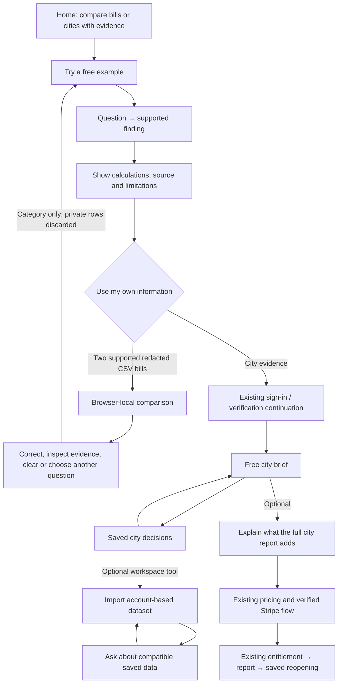

# Midnight Slate — one connected ifYouMind experience

November 20, 2026 · OpenAI / Codex · Working redesign, not released.

The founder’s connected-experience correction supersedes visual-first execution. Flow first, identity second, animation third. This branch is based on PR #118 at `2f4975f94ac888547df8b1fbdf149a50741f6570`. #118 remains unchanged, unmerged and undeployed. This is a separate design dependency, not permission to release the foundation.

## Audit and interaction proposal

The previous product had several starts: the homepage demo, a second bill chooser, an authenticated city form, Ask, a CSV workspace and a paid sample. Their different headers and vocabulary concealed the distinctions between private bill data, saved city evidence and account-based datasets. The returning page put promotional choices before saved questions. The sample showed navigation and a long notice before the conclusion. Report upgrades appeared before the complete sample. These are observable interface facts; their effect on customer comprehension is not yet measured.

One common progression: **Explore a supported question → read a finding → inspect its evidence → choose a relevant next action → return to saved work when available.** The initial primary entry is a free, explicitly labeled example. The interface must name the supported inputs and explain the destination before signup or payment.

| Route / feature | Role in the connected experience | Boundary and intended handoff |
| --- | --- | --- |
| `/` and `/#business` | One first-time entry and three supported example questions | Say what the product does and what clicking does. Tax leads; electricity and city examples use the same finding/evidence/action pattern. |
| `/discover/` | Private bill entry when category is genuinely unknown | Two supported redacted CSV formats. No arbitrary PDFs, scans, AI interpretation or account association. |
| `/discover/?example=tax` / `electricity` | Complete example and deterministic bill findings | Same category into the supported own-CSV path. No uploaded data in any navigation URL. |
| `/decide` | Existing city question and minimal evidence intake; honest bill/rate fallback | Keep current authentication and relevance boundaries. Explain account continuation and carry only existing allowlisted decision intent. Do not promise personal tax/rate answers. |
| `/sample-report` | Demonstrate the full city/Business report before a purchase | Conclusion before contents; detailed sample disclosure and sources remain. Clearly differentiate a free brief from the existing $79 report. |
| `/register`, `/login`, `/verify-email` | Save/continue an eligible city decision, or return to existing work | Same auth and verification. No account requirement for the bill example or supported browser-local CSV. |
| `/decisions` | Resume saved city questions before suggesting new tasks | Show the question, place and saved date. Bill findings are intentionally not saved here. |
| `/decisions/:id` | Existing city brief / entitled full report | Supported conclusion, evidence and relevant next check. Upgrade and reopening retain their existing checks. |
| `/pricing` | Explain the available report before registration | Free and $79 unchanged. Monthly enrollment remains closed; no household-bill paid-report implication. |
| `/account` | Identity, plan and payment-provider controls | Same permissions, quotas, entitlement states and Stripe handoffs. |
| `/data` | Optional account-based CSV workspace | Explain that imported rows are saved to the account, unlike private Bill Discovery. This tool does not feed paid Decision Reports. |
| `/ask` | Ask about compatible datasets already in the workspace | Deterministic bounded analysis, not an unrestricted chatbot. Missing data must remain an honest empty/recovery state. |
| `/advanced` | Optional detailed dataset exploration | Retain existing capabilities and authorization, reached from relevant data work rather than the primary consumer start. |
| `/growth` | Existing operational surface | Preserve its access boundary and function; not a consumer entry. |
| `/guides/`, legal pages, static 404 | Supporting explanation, trust and recovery | Same dark identity, direct recovery to examples or saved work. |
| Known `/app…` paths | Backward compatibility only | Preserve redirects and provider callbacks. No separate consumer shell. |

## Prototype checkpoint

The actual local Angular application is the connected prototype; there is no duplicate website or second application shell. Desktop and mobile before/after captures live in `screenshots/`. The before set is the untouched #118 build. All signed-in captures use synthetic demo fixtures, never customer records. Prototype layouts are implementation studies, not founder approval or observed usability results.

Before completing the implementation, walk these sequences in the localhost prototype: Home → tax/electricity example → evidence → supported own CSV → correction/clear → category-only return; Home → Census sample → free city continuation → saved decision → optional full report; saved data → bounded Ask → evidence/limitations → return. The subsequent verification record must identify broken transitions and what was corrected.

## Visual system

Midnight `#090D17`, Deep Slate `#162330`, Ice White `#F1F7FA`, Soft Blue `#7C9CFF`, Electric Cyan `#58D5E8`. Shared tokens and navigation/title/control primitives live in `_product-design.scss`. Sans headlines establish purpose; Instrument Serif is reserved for large findings and selected editorial subheads. Controls use dark text on blue, strong focus, 44–50 px targets and reduced-motion support. A white print document is an intentional paper-output exception, not a customer theme toggle. Provider-owned Stripe surfaces are outside the application’s visual control.

Remove equal-weight panels, repeated promotional starts and decorative bill artwork. Use one reading sequence, open typography and inspectable evidence. The return page is a list of questions; the report is an article. File correction and clearing remain close to the analysis.

## Founder acceptance protocol

Give a consenting first-time participant the localhost URL without explaining the interface. Ask them to describe the product, start an example, explain the finding and a limitation, find how to use their own information and explain what payment adds. Record unassisted success, wrong expectations, help requests and the first point of confusion. Use only synthetic figures and no personal information. A failure means the flow needs correction; a green automated run is not a substitute. No participant session or measured comprehension has occurred in this assignment.

## Safety and release

No backend analytical, billing, entitlement, authentication or data model changes are intended. Existing local pilots and staging AI stay separate. No production writes, merge, deployment, paid API calls, enrollment or Stripe configuration change. The redesign draft must show only its diff from #118; dispatch both workflows against its exact branch head because the existing automatic PR workflows target master. Reconcile and rerun when the foundation is separately approved. The #111 live retry gate remains unverified and is not waived here.

## Connected prototype decisions after the founder correction

- The primary first-visit action is **Try a free example**, opening the existing on-page example. The purpose sentence names bills and U.S. cities; no unrestricted question box or AI claim is added.
- Every example has a matching next action. **Compare my tax/electricity CSV** opens only the selected category’s existing file intake, with the format and no-upload boundary stated first. **Compare my cities** names the account continuation before the existing guarded city form. A quieter full-example link preserves exploration.
- The shared navigation is one presentation-only component used by public, local bill, signed-in, authentication and report surfaces. It links user goals; it does not introduce a second shell or read account state inside Bill Discovery.
- Reports demonstrate the answer first. One contextual offer follows the sample rather than repeating purchase actions above the finding. The same $79 report, free-brief scope and verified-entitlement behavior remain.
- Saved decisions lead with the saved question, place and date. Copy identifies these as city decisions and explains that private bills are not saved there. Dataset import and Ask are linked contextually with explicit account-storage and compatibility limits.
- The own-bill link adds only the allowlisted `input=csv` display mode to the existing category URL. No personal values, filenames, files or bill rows leave the browser or enter an auth return path. Unknown modes do not open a file automatically.

The first connected prototype check passed the category-to-intake and saved-question ordering cases. It also exposed inline links distinguishable only by color and mobile header test timing; these were corrected and require a fresh affected run. The initial broad local run was interrupted and is not a complete pass. Fast tests: 144 passed after updating intentional copy and the single sample-offer expectation; authentication, payment and intent assertions were retained.

## Cross-surface impact matrix

| Surface | Status | Evidence / rationale |
| --- | --- | --- |
| Home and examples | Change Required | One explicit entry, supported-purpose sentence, preserved three examples, finding/evidence and matching own-information destination. |
| Bill Discovery | Change Required | Same parsers and arithmetic; allowlisted intake mode, view-only shared navigation, correction/clear lifecycle and first-finding-first narrow layout. |
| City questions and reports | Change Required | Focused writing surface, unchanged relevance/creation rules, conclusion before contents, one sample continuation after value. |
| Saved decisions | Change Required | Saved question before suggestions; existing IDs and entitlement-backed reopening. |
| Pricing and Account | Change Required | Editorial cost disclosure, settings reading sequence and shared navigation. Existing state/controls retained. |
| Authentication | Verify Only | Presentation and navigation changed; login, signup, verification and return validation logic unchanged. |
| Commerce / subscriptions / entitlements | Verify Only | No Functions, monetization service, purchase-intent or rules diff. Closed enrollment and 79/4.99/9.99/legacy 39 behavior retained. No live transaction exercised. |
| Dataset workspace and Ask | Change Required | Explicit account-storage distinction and contextual links; same bounded data services. No provider calls or general-purpose AI capability. |
| Guides / legal / 404 | Change Required | Shared dark tokens, purpose typography and recovery paths; content and status/access behavior retained. |
| Growth administration | Verify Only | Existing operational purpose and authorization; shared palette inherited. Not introduced as a consumer entry. |
| Responsive / accessibility / feedback | Change Required | Four-width captures, keyboard, axe, non-color link distinction, native menus/disclosures, reduced motion, existing loading/error recovery. |
| Analytics / infrastructure | Not Affected | No tracking events, schemas, provider configuration, deployment workflow or infrastructure change. Existing scoped authenticated events remain. |
| Documentation / artwork | Change Required | This audit/prototype, permanent instructions, handoff and six unsent synthetic editorial exports. |

## Verification and limitations

Local `npm run build`, `npm run build:local`, 146 fast checks, 32 targeted authenticated browser/accessibility checks and the production/island guards passed at their recorded checkpoints. New targeted tests cover supported-category intake, no unsupported explanation for missing input, state clearing, saved-question ordering and conclusion-before-contents. Exact-head Linux CI is blocked by the verified GitHub account billing lock; it remains required for release. Initial Hosting verification exposed stale typography/label assertions and an actual first-finding placement problem at 320 px; correct the layout rather than removing that viewport requirement. The source review retains all existing verification/payment/intent tests while changing the intentional single sample-offer expectation.

Final local production build measured 693.28 kB raw / 185.14 kB estimated transfer versus #118's 683.74 / 183.19 kB: +9.54 kB raw and +1.95 kB estimated transfer. The local bill island measured 246.71 / 68.21 kB versus 240.73 / 67.42 kB. These are build estimates, not field speed measurements. The island remains three allowlisted assets with no provider endpoints. Stylesheet warning budgets remain exceeded on several views, while hard budgets pass; the report stylesheet is smaller than #118's. The desktop decorative image is lazy-loaded and hidden on phones. No new runtime dependency or remote font was added.

Baseline changes require individual expected/actual/diff review. Do not accept them automatically. Functional, Linux visual and exact-head workflow outcomes are recorded on the draft. Native iPhone/Safari, spoken VoiceOver, actual print-device behavior and the founder's five unassisted human tasks remain untested. No visitor acquisition, preference, purchase or comprehension outcome is invented.

## Reproduction and release dependency

Use the repository's existing local/emulator scripts. The capture helpers use installed Chrome; Linux CI uses the locked Playwright browser. A default local browser launch was unavailable, so that attempt did not execute product checks. The 32-case corrected targeted run used `QA_PORT=4309 QA_BROWSER_CHANNEL=chrome firebase emulators:exec --project demo-ifyoumind --only auth,firestore,functions "npx --no-install playwright test --config e2e/playwright.config.mjs e2e/specs/connected-journey.spec.mjs e2e/specs/midnight-experience.spec.mjs e2e/specs/layout-a11y.spec.mjs e2e/specs/sample-report-mobile.spec.mjs --workers=1"`.

Artwork: `QA_BROWSER_CHANNEL=chrome node scripts/render-midnight-social.mjs --png` renders 1080×1080, 1080×1350 and 1080×1920 for tax and electricity. Each export labels illustrative status, non-customer provenance and limitations; amounts derive from the existing fixtures. These docs assets do not ship with the app and have not been posted.

The draft is stacked on #118 so its review contains only this redesign. Dispatch `launch-build-check.yml` and `authenticated-qa.yml` on the exact redesign branch. Launch previously had no manual trigger; this candidate adds only `workflow_dispatch` to that non-deploying check so stacked review can be verified. Production release automation is unchanged. Before any future release, separately approve/release the foundation, reconcile master and rerun checks, observe the five-task human acceptance, and obtain exact-head design/production approval. Retain the verified Hosting rollback and compatible backend. A future visual rollback should restore the separately released foundation; its deployed version is not known yet. No rollback execution is authorized here.

### Narrow-screen prototype correction

The first broad Hosting run passed 66 cases and exposed outdated copy/typography/menu assertions plus an actual 320 px finding-placement issue. After the intentional assertion updates, 79 passed and five remained. A targeted rerun then passed eight of nine after removing a duplicate findings heading, keeping ready-state announcements accessible but visually quiet, and moving the CSV continuation after the first finding. The final remaining issue was the unknown-category chooser burying its action below a long tax question and preview. It now asks only **Choose a bill.** with its example action before preview detail. Links from a known example bypass this chooser. These corrections preserve arithmetic, limitations, keyboard evidence and private-data clearing; exact-head CI must verify the final result.

The first Launch manual dispatch was rejected because its workflow lacked a manual trigger; it did not run or deploy anything. The existing non-deploying build receives a manual trigger on this design branch. No production workflow, release trigger or permission is changed.

## Final local review checkpoint — November 20

Draft [#119](https://github.com/alwat83/ifyoumind/pull/119) remains stacked on protected #118. UI source checkpoint `1f800024f50650b81e6a656f648b12ed50bb27a5`; the final follow-up also corrects dark-on-dark action labels in Ask/advanced, narrows advanced-analysis capability wording, extends the existing route accessibility check and refreshes test/evidence captures. Final candidate SHA and exact-head workflow results are recorded in the PR. [Detailed local verification](LOCAL_VERIFICATION.md) distinguishes successful checks, initial failures and targeted reruns.

- Final complete Hosting suite: **84 passed**, including 320 px. Narrow finding/qualified-answer checks: **9 passed** without removing placement assertions.
- Full authenticated sweep: **179 passed, 3 failed, 14 Linux-only visual cases skipped**. Two failures were the expected Chrome offline console message; the third submitted an empty Name once. Auth implementation was unchanged. The scoped offline diagnostic allowance and explicit form/value readiness assertions passed **12 repeated targeted cases**. The original Name-loss cause is not conclusively established; this is not a newly green full sweep.
- Final secondary-route accessibility/return/report rerun: **6 passed** after actual screenshots exposed dark-on-dark Ask/advanced action labels. Corrected primary/disabled colors and removed the advanced page's unrestricted “anything” wording. Shared arithmetic and data services are untouched.
- Functions **72**, fast web **146**, rules **8**, organizations **5**, fixture/access **24** passed; one historical fixture skipped. Commerce **47 passed, 1 failed** with Firestore emulator `Transaction is invalid or closed`; the identical month-boundary concurrency case passed unchanged in a fresh emulator. No quota/concurrency assertion or backend implementation was weakened. A clean full commerce CI remains a release gate.
- Refreshed complete after captures at **1280, 820, 390 and 320 px**: 40 screenshots, zero horizontal overflow. Own-input/evidence and six data/Ask/advanced captures add desktop/mobile detail. Screens are actual local app routes with synthetic fixtures. Navigation, evidence, keyboard, axe and reduced-motion checks are automated engineering evidence, not spoken screen-reader or human-comprehension results.
- Both manually dispatched workflows on `1f800024…` failed before any step. [Launch 44835415458](https://github.com/alwat83/ifyoumind/actions/runs/44835415458) and [QA 44835419791](https://github.com/alwat83/ifyoumind/actions/runs/44835419791) independently report: **“The job was not started because your account is locked due to a billing issue.”** No runner, billing setting or security control was changed. Final exact-head attempts are linked from the PR; the Linux baselines remain untouched and require individual actual/diff review after account restoration.

Fresh read-only production metadata retained Hosting `39dc573f3826dca6`, release `1794933315802000`, and `createmarketintelligenceproject-00087-nub` ACTIVE at 100%. Prior Hosting `cd0b78221355e0f4` remains finalized. This design was not merged or deployed. #118's head remains `2f4975f94ac888547df8b1fbdf149a50741f6570`. No production write, payment, customer record, provider generation, entitlement or enrollment change.

**GO for connected-prototype founder review; NO-GO for production.** Remaining gates: restored GitHub execution and clean exact-head checks; individually reviewed Linux visual differences; real unassisted five-task acceptance; separately approved foundation reconciliation and release scope, including the unwaived #111 live retry. The current strict CSV requirement is a material consumer usability limitation, not arbitrary bill/PDF support. No new parsing feature is proposed here.

## Local-first continuation — founder authorization, November 20

The account lock no longer gates development or founder experience review. [The single local verification command](../../verification/local-first/README.md) runs the applicable Launch/QA checks, records exact-source integrity, and offers optional pinned Linux Docker with native fallback. Failures and unsupported Linux coverage remain explicit. GitHub workflow definitions are preserved; local verification is not release authorization. Final executed evidence will be linked from the draft and handoff. Do not wait for billing restoration to conduct the five-task prototype review.

The [first complete local gate](../../verification/local-first/VERIFIED_2583bf5.md) is preserved with 684 pass / three fail / 15 skip and valid exact-source integrity. It found an actual standalone mobile placement issue (fixed with spacing, assertion retained) and two failed concurrent-save cases (backend untouched, not waived). The resulting final head is rerun separately and linked from the PR. No GitHub billing action is necessary to review the real prototype. Supported Linux baseline review and human acceptance still remain.

## Founder-selected question/reveal refinement

The founder selected A's question-led first screen with B's immediate answer payoff and authorized implementation in #119. [Selected implementation, original A/B/C comparison, actual before/after screenshots and five-task protocol](first-five-seconds/REVIEW.md) supersede earlier recommendation of B. The homepage now reveals the existing figures in place; private CSV, city/report, auth and commerce boundaries remain. Exact-head verification uses the local-first gate; no merge/deployment authorized.
