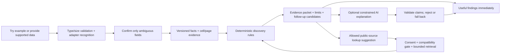

# Automatic discovery — founder review proposal

October 23, 2026 · OpenAI / Codex · **PROPOSED, not an approved implementation or live capability.** Audit source: deployed master `74a91fb15d408893448f925cedcec4e47868dec0`. Existing Business offers and production remain intact. Outbound **Pending Founder Setup**.

**Mission:** make AI-driven data discovery accessible to people who do not know AI or prompting. **Promise: “You bring the data. We’ll find the story.”** The product takes the first analytical step; people should not need to invent a question, select a statistical method or understand a dataset schema. This supersedes treating the homepage as a brochure or an end in itself. Interesting presentation serves useful discovery; it does not substitute for evidence.

## Decision requested

Approve a bounded discovery proof of concept, not a general upload platform: one two-year property-tax statement schema, deterministic change findings with exact evidence, an automatic plain-language summary, and suggested next checks. Start with an explicit sample and a recognized redacted CSV; add one jurisdiction's text-PDF template only after scope/data/privacy approval. Keep AI optional and disabled until a separate provider-processing/cost/evaluation gate passes. No public upload claim, production changes, new paid offer or broad rewrite in this assignment.

## Verified architecture and capability audit

| Existing asset | What is verified | Reuse and boundary |
|---|---|---|
| Angular public homepage/sample, guarded `/app/data` | Public sample works live after #68; private CSV route exists in `app.routes.ts`. `consumer-data.component.ts` reads CSV locally, suggests known header aliases, asks for mapping and creates a dataset/import. | Reuse browser parsing, responsive controls, error/retry conventions. Import does not initiate automatic discovery. Guarded CSV is narrower than arbitrary documents; no positive live import/write performed in this audit. |
| `csv-parser.ts`, `consumer-data.component.ts`, `data-import.component.ts` | CSV quoting/header/row-shape validation; browser limit2MB/400rows; explicit numeric/period mapping. | Reuse parser behind a new validated schema adapter; do not equate header guessing with reliable semantic extraction. Missing numeric cell is converted by `Number('')` to0 in existing import conversion; reproduced locally. New adapter must reject missing/ambiguous values, not copy this behavior. No fix claimed. |
| `universal-data.ts`, `universal-import.ts`, `authorization.ts` | Authenticated membership/role checks, typed observation fields and dimensions; server import1–400rows. Dataset/observation writes use transaction caps. | Reuse authorization and bounded persistence interfaces. Current model is one metric per dataset; add a document/field evidence layer, then expose compatible derived observations. Do not force a whole statement into one numeric series. |
| `universal-limits.ts` | 50datasets/workspace,5000observations/dataset,10max instances; per-user UTC daily quotas, bounded reads. Analysis reads at most500observations/dataset; selection2–8datasets. | Useful existing controls, not a private-upload/AI cost policy. Reads can use a subset even when stored data is larger; discovery must disclose coverage, never silently analyze only the first500. |
| `universal-analysis.ts`, `universal-reasoning.ts`, `universal-ask.ts` | Exact period/geography/entity matching, Pearson association with minimum3pairs, source labels, caveats, saved run summaries. Ask is lexical target matching + deterministic analysis; requires a typed question and multiple datasets. | Reuse pure matching/calculation utilities where valid. Replace question-first orchestration for this new slice. Two tax years permit change arithmetic, not correlation or a trend/causal explanation. Duplicate keys/units/period semantics require explicit validation before alignment. Current confidence labels are heuristics, not calibrated certainty. |
| `market-intelligence.ts`, `market-analysis.ts`, frontend `evidence-summary.ts` | Census2024/2019 ACS5 place-level data, FIPS resolution/cache/retry/12s fetch deadlines; deterministic findings/report/limitations. Current endpoint requests estimate fields, not MOEs. | Extract small source/provenance adapters later, preserving current reports. City demographics/home value are not parcel tax rates, assessments or business demand. Add MOE/annotation/definition/vintage support before new statistical comparison claims. |
| `market-report.component.*`, report entitlement/monetization logic | Public sample, source links, limitations, print/copy and existing79USD report/39USD monthlyPro/five reports. #68 recovery deployed and read-only smoke passed. | Reuse presentation patterns and scoped access. New discovery report type needs its own schema; do not silently attach personal tax analysis to current Business SKU or change pricing. |
| `ai-synthesis.ts`, `market-ai.ts` | Source-packet prompts, signal-ID/numeric-token checks, response parsing, output caps and `store:false` in code. Neither synthesis callable exported by `index.ts`; **neither appears in the fresh deployed function-name inventory**. Frontend service still has a synthesis call path. | Prototype code only, not live AI. Reuse packet boundary idea, not code wholesale: numeric-token membership cannot prove correct attribution/units or exclude unsupported causal prose; transport cancellation, schemas, quotas and adversarial evaluation need work before activation. `store:false` alone is not an end-to-end privacy/retention guarantee. No key read or model call performed. |
| FRED worktree `1a7c78c`, `fred-economic.ts`, `fred-observations.ts` | Separate source supports five allowlisted macro series,24observations,1h memory cache,12s fetch timeout and source/retrieval metadata. Not in deployed master/function-name list. Existing worktree changes preserved. | Review adapter concepts later; no blind merge. Preserve series units/frequency/seasonal adjustment/vintage before joining. Macro indicators do not explain an individual tax bill or supply municipal rates. Not needed for first slice. |
| Firestore/Storage and privacy policy | Workspace membership governs dataset reads; server-mediated writes. Storage attachment/media rules permit reads to any signed-in user, not a private-document owner boundary. Policy states general retention; no audited document-ingestion lifecycle/deletion system found. | **Do not use legacy attachment paths for tax files.** New private paths/owner enforcement, deletion lifecycle and clear notice are prerequisites before server document upload. Existing policy text is not proof of implemented controls. No production rules/policy changed. |

Function inventory was read using existing Firebase access after deployment; only sanitized capability presence/absence is recorded, not raw deployment metadata or credentials. Historical security audit estimates are not current measured costs/traffic. No real user/customer activity is inferred from source or tests.

## Extensible architecture — a vertical slice in the existing stack

Keep Angular, existing Functions and Firestore. Add one adapter and discovery orchestrator behind a disabled/private experiment gate. No microservice rewrite, vector database, agent framework, general document crawler or new infrastructure for the first slice. Start synchronous/local for small data; introduce bounded resumable jobs only when real document extraction needs them.

### Contracts to stabilize, not a universal ontology to build now

- **IngestionSession:** owner/workspace, state, adapter/version, source hashes, consent/purpose, limits, expiry, idempotency key, coverage and validation errors. States: received → validated → needs-confirmation/ready → analyzing → complete/failed/cancelled/deleting/deleted. Retry resumes the same version; duplicate import does not duplicate observations/charges.
- **SourceArtifact:** owner, original type, safe display name, hash, capture date and jurisdiction if provided. Raw content reference is optional, private and expiring. No secret-bearing URLs or address/parcel identifiers in logs/analytics.
- **Fact:** metric ID, raw token, normalized decimal/minor units, currency/unit scale, tax year vs billing/payment period, entity token, geography IDs, definition and assessment basis, missing status, adapter confidence/validation flags, and `EvidenceRef` (source hash + CSV row/column or PDF page/bounding box). Versions are immutable; corrections invalidate dependent findings.
- **Finding:** kind (`calculation`, `interpretation`, `external_comparison`), fact/evidence references, formula/rule ID, coverage, caveats and suggested next-check IDs. Store precise internal values; round only display. No unsupported finding to fill an empty result.
- **ConnectorResult:** official source URL/provider, source version/retrieval time, geography/boundaries, observation period, units/definition, release/vintage/seasonal adjustment, uncertainty and license/attribution. Joining requires compatibility evidence; same city name is insufficient.
- **DiscoveryReport:** ordered useful findings, “what we can’t tell,” traceable inputs, optional AI version and follow-ups. Rank by reproducible relevance (size/completeness/user context) rather than “most surprising correlation.” Show an honest no-finding result when data is insufficient.

Adapter interface: `recognize → extract → normalize → validate → confirm-needed → facts`. First supported template is explicit. Future text-PDF/OCR/XLSX/other adapters implement the same contract without changing existing Business reports. Unknown format/template is rejected with a useful alternative, never “best effort” silently accepted.

## Narrow proof of concept: “What changed in these two bills?”

**Proposal, not a completed end-to-end feature.** Prepared arithmetic fixture is synthetic; no homeowner data, tax authority records or AI-generated facts. Scope: one property token, one currency, two distinct consecutive tax years, matching three component definitions and total. Supported input is one recognized redacted CSV (or an included example). No parcel/address required. Accept annual billed amounts, not unexplained payment transactions. One optional screen confirms detected years, currency, components and totals; no prompt box or dataset/method selection.

| Synthetic statement field | 2024 USD | 2025 USD | Verified arithmetic |
|---|---:|---:|---|
| County line | 900.00 | 990.00 | +90.00 /10% |
| School line | 2400.00 | 2640.00 | +240.00 /10% |
| Municipal line | 900.00 | 990.00 | +90.00 /10% |
| Total billed | 4200.00 | 4620.00 | +420.00 /10% |

Automatic first findings, without a question:

1. **Calculated:** “The total billed increased by420USD (10%) between these two statements.” Cite both total cells and formula `(462000−420000)/420000`; integer cents used.
2. **Calculated:** “The school line accounts for240USD of the420USD increase (57.1%).” This is an arithmetic contribution, not a causal explanation of policy or assessment.
3. **Calculated pattern:** “Each of the three listed components rose10%; the component sums match each year's total.” Two observations show one year-to-year change, not a long-term trend or statistical anomaly.
4. **Known limit:** “These statements alone do not establish why the charges changed or whether the assessment is correct.” No appeal eligibility, future tax forecast, savings claim or individual financial advice.
5. **Suggested next checks:** Did assessment/exemptions change? Are there rate or jurisdiction changes to verify in official notices? Which nearby comparison has matching year, property class, assessment basis and taxing jurisdictions? Questions are not asserted causes.

**AI interpretation, later optional:** translate the validated facts into concise context and prioritize questions; it cannot calculate new amounts, decide the tax is unfair or supply unseen reasons. Each interpretive sentence references permitted finding IDs. If unavailable or rejected, deterministic cards remain useful and the AI status is honest.

**External comparison, deferred:** do not claim a nearby municipality is cheaper from Census/FRED or name matching alone. First choose one real jurisdiction/official source and verify definitions, tax year, assessment basis, exemptions, property class and geographic service boundaries. Obtain consent before sending even a coarse location to a source. Cache cited public data separately from private user facts. Refuse incompatible comparisons, and show not available rather than fabricate neighbors.

For the founder's PDF scenario: Phase2 adds **one** authorized jurisdiction's text-PDF template, at most two files/ten total pages/5MB per file as proposed caps. Verify extracted amounts against page evidence and require confirmation for ambiguity. Scans/OCR, handwritten bills, password-protected documents, mixed templates and arbitrary files are deferred. CSV-first validates discovery but **does not validate statement extraction**; that limitation must be explicit at the next gate.

## First-time experience — no AI literacy required

1. **First five seconds:** “You bring the data. We’ll find the story.” Primary action **Try two example statements**; secondary **Use a supported file** only after that feature is approved/working. An example offers immediate no-registration value without asking a visitor to upload private documents blindly.
2. **First click:** the example opens two readable statement summaries with “Example data—not your taxes.” The sample runs locally. No simulated AI typing or claim that a model was used.
3. **Recognition:** “Two annual statements,2024 and2025. Here’s what I found.” For personal input, confirm only uncertain fields. Wrong type, missing amount or mismatch gets a specific correction action; no forced account or payment before the example.
4. **Automatic discovery:** show the three findings above, with clear Calculated/AI interpretation/External comparison labels as applicable. AI and comparison sections are absent or explicitly unavailable until enabled; not mocked as completed work.
5. **Depth after engagement:** “Show how you found this” opens the exact source cells/pages and arithmetic. “What should I check next?” shows grounded follow-up suggestions; no need to write a prompt. Correct an input and recompute all dependent findings.
6. **Control and recovery:** replace data, retry failed interpretation, delete/clear data, or return to the example. A model/provider failure never removes verified calculations. Public-share actions disabled for personal files by default; intentional export warns about identifiers and previews content.
7. **Optional next value:** save a private report only with explicit choice/authentication once supported. No new price or promise of paid personal-tax analysis. Existing Business sample/free brief/79report/39monthlyPro remain separate for relevant business needs.

The earlier Split/Trade-off/Reveal homepage prototypes are local exploration, not an approved product implementation; their question/choice mechanics may inform engagement. The founder's automatic-discovery mission now governs the implementation proposal. Do not invest further in a full question-led redesign before this slice is reviewed.

## Privacy, file safety, reliability and cost gates

- **First local example/CSV experiment:** browser memory only, no upload, model call, persistence, analytics of contents or background network. Clear on explicit reset/tab close; no claim that browser/OS crash recovery is cryptographically erased. No filename/address/parcel in events. Existing registered CSV persistence remains a different current capability.
- **Server upload, only after approval:** tenant/owner-scoped quarantine; server validates actual type/magic bytes, size/page/row/cell limits, archive/macro/embedded-script/active-link handling; private authorization on every read. Opaque object IDs, no public download links. Sandbox extraction with deadlines; no opening remote links from a document. Treat document/source text as untrusted data, never executable model instructions. Scan malicious files before extraction; choose a provider only with approval.
- **Minimize:** redact owner/address/parcel/payment identifiers before any optional model transfer; model sees the smallest structured evidence packet. Opt-in and provider terms/retention documented first. Do not promise “never stored” or “never used for training” without verified settings/contracts. No API secrets in browser.
- **Retention proposal:** browser-local by default; for future server pilot delete raw files within24h of extraction, unfinished jobs within24h, private normalized facts/reports within7days unless explicitly saved. These are **proposed policies, not implemented guarantees**. Gate release on verified deletion across object storage, fact/run records, caches and derivatives; disclose backup/log retention honestly. Delete-now cancels jobs and prevents retries/recreation. Account/workspace deletion and authorization are tested. No TTL assurance merely because a timestamp field exists.
- **Cost:** deterministic local example uses no paid API. Proposed pilot max2files,400CSVrows,5findings,3follow-ups,one optional model request/run, bounded input/output tokens and explicit transport timeout; no recursive agents/tools/automatic paid retries. Reserve spend atomically before dispatch; per-user and global daily limits, dedup/cache within the owner/version and kill switch. Estimate cost from the approved model's current rates before enabling. Founder approves provider, per-run and total pilot budget; no spending authorized here. Measure actual tokens/compute/storage/egress with coarse operational records, not a new analytics platform. No profitability claim from unknown costs.
- **Correctness:** distinguish absent/zero/negative, currency/locale, tax year/payment date, duplicate/corrected statements, incomplete components and unit scales; reconcile totals before decomposition. Zero denominator yields “percentage unavailable.” Two years never trigger correlation, outlier or causal claims. For larger datasets, add justified sample/overlap/multiple-testing rules before broad discovery, not the current max-correlation heuristic as a conclusion engine.
- **AI guard:** validated structured output, permitted finding IDs, field-level provenance/units, no new facts/amounts/entities/causes, adversarial prompt-injection fixtures and semantic evaluation. Numeric allowlists alone are insufficient. Unverifiable output is discarded and visibly replaced by deterministic content. No claim that these measures mathematically eliminate hallucination.

## Phased plan and measurable acceptance

| Phase | Small deliverable | Acceptance / approval gate |
|---|---|---|
| 0 — this assignment | Source audit, contracts, synthetic two-statement arithmetic, walkthrough and bounded proposal. No production/model calls. | Founder reviews schema/usefulness, CSV-first vs one text-PDF template, privacy approach. No approval inferred from this document. |
| 1 — after scope approval | Local no-prompt sample + recognized CSV discovery, source-cell views/corrections/reset, deterministic questions. New isolated component and pure rules; no Business rewrite. | Golden fixture arithmetic exact; missing/zero/duplicate/mismatch/unsupported format tests;100% findings traceable; zero unsupported numerical/causal claims in curated fixtures; desktop/mobile keyboard/a11y. Engineering targets: first sample finding≤2s on reference device; report measured results, not forecasts. |
| 2 — separate data/file approval | One jurisdiction's authorized text-PDF adapter; private owner storage/deletion only if needed, otherwise local. | Authorized/redacted evaluation set; all displayed amounts confirmed against source; ambiguity forces review; deletion/isolation/injection/limits/timeout tests pass. No general “any document” claim. |
| 3 — separate AI/provider/budget approval | Optional constrained summary of the same evidence packet; deterministic fallback. | Spend limits and opt-in pass; every output claim traceable, failures rejected; groundedness/unsupported-cause evaluation; record actual latency/cost. AI model activation/export/deploy explicitly approved. |
| 4 — pilot/public release approval | Permissioned novice usability observation; only then decide a small public rollout or one verified external comparison. | Target:4/5 novices reach a correct useful insight in≤60s without prompting,4/5 distinguish fact from interpretation and name a limitation; source inspection/error recovery observed. These are proposed acceptance targets, no participants/results claimed. Invitations/outreach remain Pending Founder Setup until separately reopened. |

No new consumer monetization SKU until usefulness/willingness-to-pay evidence and founder commercial approval. Measure one useful discovery, comprehension and trust—not uploads, generated words or dashboard views. Keep first genuine customer objective; build the minimum that demonstrates value.

## Reviewed sources

Primary repository evidence is pinned to deployed74a91fb; paths above identify implementation. Separate FRED commit1a7c78c is explicitly unmerged. Fresh production function-name list confirms no synthesis/FRED callable. No real user data imported or external provider secrets inspected.

- [Census comparison guidance](https://www.census.gov/programs-surveys/acs/guidance/comparing-acs-data.html): account for estimate uncertainty and changing variables/geographies before comparisons.
- [Census2024 comparison notes](https://www.census.gov/programs-surveys/acs/guidance/comparing-acs-data/2024.html): geography and period/price-basis changes constrain comparisons.
- [FRED observations API](https://fred.stlouisfed.org/docs/api/fred/series_observations.html), [real-time periods](https://fred.stlouisfed.org/docs/api/fred/realtime_period.html): retain units/frequency/transformation/aggregation/vintage metadata when adapting a future connector. These sources describe data semantics, not evidence that local tax comparisons are implemented or valid.

## Next recommended assignment

After founder scope approval, implement Phase1's **local automatic-discovery slice** with the small synthetic fixture and source-cell tracing; include strict missing-value handling. Separately, the smaller immediately evidence-backed consumer polish remains descriptive dataset/vintage source links in existing reports, with unchanged destinations and focused accessibility regression. Neither justifies a large rewrite or speculative analytics. No new merge/deploy/outreach/Stripe action authorized by this proposal.
