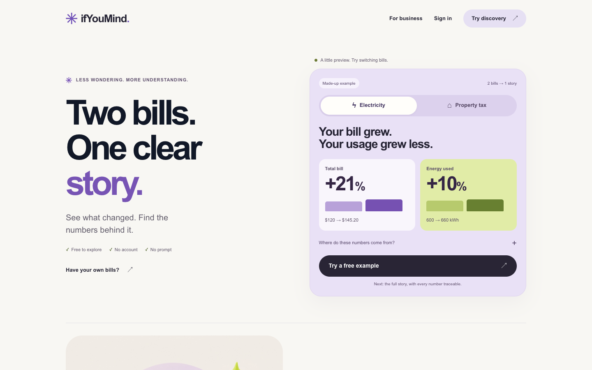
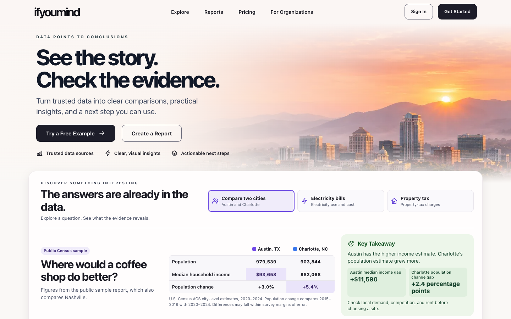
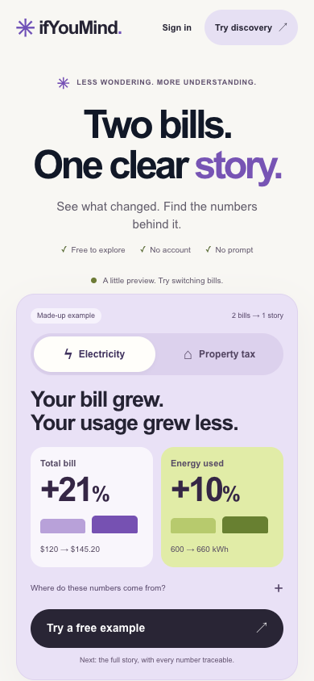
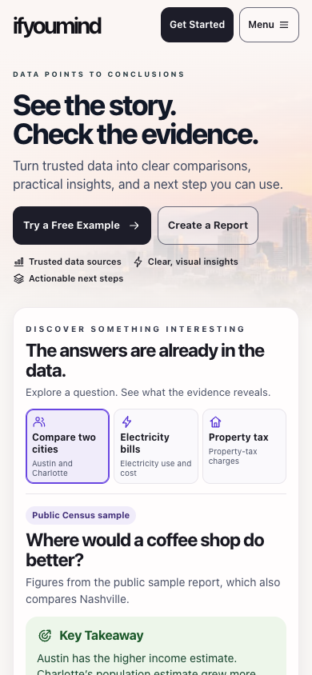

# PR #82 founder release review

November 11, 2026 · OpenAI / Codex · **NO-GO for production. The live default passed readback and the signed-in owner test failed.**

[Draft PR #82](https://github.com/alwat83/ifyoumind/pull/82) is open and mergeable on `codex/integrated-release-20261110` at `6fcef3ab84c793c5b93f559c0d9c6d6d7aefaeba`. GitHub master and the last successful production deployment are at `e5d8f15fb9171a3723fdfc324dd0066d8d5caf5e` (PR #76). A fresh public GET showed the production bill-led hero. The release candidate has not advanced since its verified checks. This evidence is on a separate documentation branch so the reviewed SHA stays fixed. [Last production workflow](https://github.com/alwat83/ifyoumind/actions/runs/42143112840)

## First screen

Fresh Chrome captures at identical viewports. Production was read from ifyoumind.com. The candidate used its existing production build locally. Non-GET and external requests were blocked. Both returned 200 at 1440×900 and 390×844 with zero horizontal overflow.

| Production desktop | PR #82 desktop |
| --- | --- |
|  |  |

| Production mobile | PR #82 mobile |
| --- | --- |
|  |  |

**Five-second review.** The candidate's skyline, two actions and three example choices present the broader product on the first screen. The headline is general. The subheading and city preview do the work of explaining sourced comparisons. Production gives visitors a concrete bill finding without a tap. In the candidate, the mobile comparison table and source disclosure sit below the first fold. The primary free action opens the full electricity example and can take visitors past the on-page picker. This is the principal first-use risk to observe. The visual review found no blocking layout problem at the captured widths. Five-second comprehension remains a hypothesis until tested with first-time visitors.

## Before and after by task

| Task | Production | PR #82 |
| --- | --- | --- |
| City comparison | The three-city income preview sits lower on the homepage. | Austin and Charlotte are the opening example. Two measures, a dated Census source and limitations are visible. The full sample explicitly adds Nashville. [City evidence](screenshots/desktop-city-evidence.webp) |
| Electricity and property tax | The hero offers both bill examples and an arithmetic disclosure. [Live disclosure](founder-review/production-1440-evidence.webp) | All three examples switch in place. The electricity comparison shows +21% billed and +10% energy use, with $25.20 in raw-cell evidence. The tax example attributes 57.1% of the increase to school charges. [Electricity](screenshots/mobile-electricity.webp) · [Source cells](screenshots/mobile-evidence.webp) |
| Business sample | The long question and table of contents precede the comparison. [Before](../../product/business-report-proof-20261106/screenshots/before-desktop.png) | Two comparisons and their limitations lead the report. Visitors can inspect both ACS periods and see the follow-up research. [After](screenshots/desktop-sample.webp) · [Mobile report](screenshots/mobile-sample.webp) |
| Pricing | The three offers are visible as direct links. [Live pricing](founder-review/production-1440-pricing.webp) | The same offers are visible and Compare Plans explains what is included without sign-in. Both paid options unlock the same full report. [Open pricing](screenshots/desktop-pricing.webp) |
| PDF | A prior production Letter export with backgrounds shows a dark final-page canvas. [Before](../../product/experience-audit-20261106/screenshots/print-letter-backgrounds-last-page.png) | The existing A4 and Letter review shows white pages, readable tables, both measures and Census sources. [Five export variants](screenshots/pdf-review.webp) |

The fresh candidate walkthrough passed example switching, electricity source-cell expansion and plan comparison at both widths. The retained sample and print captures use the reviewed public data fixture. No new live report generation or signup was exercised. The examples label synthetic bills and the city evidence as estimates. The city findings do not claim that income or population establishes business demand. The bill and tax examples report observed arithmetic without claiming a cause.

## Release checks

- The two workflows passed on the exact candidate. CI recorded 306 browser cases, including 69 Hosting and 126 authenticated cases, plus 145 web tests, 72 Functions tests, 7 Firestore rules tests, 5 organization tests and 31 commerce tests. One existing fixture test was skipped. [Launch build](https://github.com/alwat83/ifyoumind/actions/runs/42971126444) · [Authenticated QA](https://github.com/alwat83/ifyoumind/actions/runs/42971126409)
- Reviewed evidence covers mobile from 320px, keyboard Menu and disclosures, desktop, and 40 pages from five PDF variants. The billing sandbox verified scheduled Pro retention, terminal downgrade, preserved unlocked reports and continued billing access. The terminal test used an explicit end of the disposable sandbox subscription. [Billing evidence](BILLING_PORTAL.md)
- The earlier live read confirmed the active $79 one-time and $39 monthly prices. The five-report Pro allowance remains verified by CI. The original portal configuration gap is now resolved. See the fresh live evidence below.

## Live billing readback and signed-in test

| Gate | Evidence | Result |
| --- | --- | --- |
| Intended live default | Read-only Stripe API retrieval and account configuration list both returned `bpc_1UapiPCigpG2y4hQWObTWhEc` with `livemode`, `active` and `is_default` true. Invoice history and payment-method updates enabled. Subscription cancellation enabled at period end with no proration. Plan switching disabled. Default return URL `https://ifyoumind.com/app/account`. | Pass |
| Owner access through ifYouMind | Founder signed in for the test. The live Pro Account page exposed **Manage billing**. Two attempts stayed at `https://ifyoumind.com/app/account` with “Billing management could not be opened.” | Fail |
| Backend diagnosis | Scoped Cloud Logging for `createBillingPortalSession` recorded HTTP 500 at 04:53:05 and 04:53:13 UTC on November 12 (November 11 Pacific). Both corresponding application errors reported Stripe’s **No such customer** for the linked reference. An independent lookup did not establish the reference’s account or mode. Customer identifiers and session tokens are omitted. | Invalid or unresolvable customer link for the deployed Stripe connection |
| Hosted portal and return | Stripe did not issue a usable session during either attempt. The authenticated return from Stripe and live control visibility could not be exercised. The candidate’s owner/admin enforcement and cancellation behavior remain verified by existing emulator and sandbox evidence. | Blocked |

The candidate and deployed callable use the server-side workspace customer and the same fixed return URL, with no explicit configuration ID. Stripe uses the account default when the ID is omitted. The candidate improves authorization, redirect validation and cancellation state. It does not repair a workspace’s Stripe customer link. The signed-in production check exercised PR #76’s deployed path. The two exact-head PR #82 workflows remain green. [Stripe session API](https://docs.stripe.com/api/customer_portal/sessions/create) · [Sandbox and candidate evidence](BILLING_PORTAL.md)

## Remaining gate and exact authorization

First verify a workspace’s current billing customer reference and the account/mode used by the deployed Firebase function, using redacted operational evidence. If another authorized workspace already has a verified matching live link and Manage billing access, use that workspace for the non-destructive smoke. If the intended owner workspace needs a link repair, or the deployed connection needs repair, obtain founder authorization for the exact verified change. Do not infer ownership from email or create a customer or subscription to satisfy this check.

Repeat **Account → Manage billing → Stripe-hosted portal → Return to ifYouMind**. Verify the correct workspace, invoice and payment controls, cancellation control where a subscription is eligible, and the exact authenticated Account return. Do not change payment methods or subscriptions. Once the live smoke passes, request separate founder approval of the exact candidate and automatic master deployment.

## Deployment and rollback

Before an authorized merge, recheck the draft SHA, master, CI and retained Firebase versions. The master push runs the production Firebase workflow. Compare the merge tree to the approved candidate, then smoke-test the homepage and discovery, sample and print, pricing and registration intent, and authenticated Account and report access. No live purchase is required for this smoke test.

The recorded prior Hosting version is `f76d7036fa558cf7`, from `e5d8f15`. Confirm it is available before release. If rollback is authorized, restore that Hosting version and the matching Functions revision from the prior release, then revert the integration on master before any subsequent deploy. Verify the restored paths. Treat Stripe configuration rollback as a separate approval.

## Next growth milestone

After the release decision, run a short first-use round with five people who have a real decision. Observe what they understand in five seconds, whether they try an example, find its evidence and can explain the free brief versus the paid report. Use the existing consented funnel or a simple manual record to count demo starts, evidence opens, sample views, checkout starts and independently verified report purchases. Prioritize the first observed drop-off. The current checks establish behavior. Customer conversion, revenue and incremental lift remain unmeasured. External outreach remains Pending Founder Setup.
